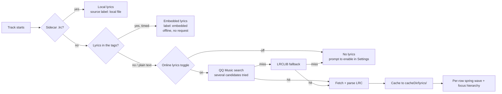
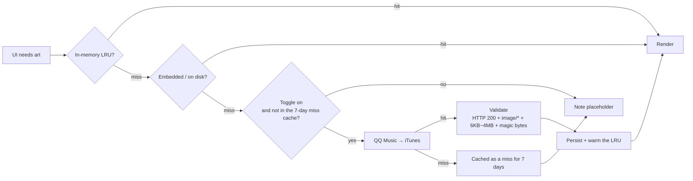

<div align="center">

# Melody Retro

**Your album art picks the theme — not the wallpaper.**

A fully offline local music player for Android. Not a RetroMusicPlayer fork: it's a from-scratch
Kotlin + Jetpack Compose rewrite of its design language, with one twist — every accent color is
pulled from the cover art of whatever's playing.


[](https://github.com/Sanye223/Melody-Retro/releases/latest)


[简体中文](README.md) | **English** | [日本語](README.ja.md)

</div>

---

## TL;DR

| | |
| --- | --- |
| **What** | Offline music player, Material 3 bones, RetroMusicPlayer's skin |
| **Why** | Half your library has no lyrics, no cover art, no tags. This one goes and gets them. |
| **How** | `MediaStore` + Media3/ExoPlayer, Compose UI, zero backend, no account |
| **Stack** | Kotlin 2.0.21 · `compileSdk 35` · `minSdk 24` |
| **State** | 113 unit tests green, 6 of them hit live endpoints |

No telemetry. Two network switches, both off = zero requests.

## Why bother

Most local players look the same: white list, one fixed accent color, lyrics that either don't
exist or don't scroll. Three things here are deliberately different:

1. **Every track gets its own palette.** `Palette` pulls `vibrant` out of the cover art and drives
   the whole player — full-screen gradient, play button, seek bar, mini player, lyric highlight.
   Change the track, the entire UI changes with it.
2. **You don't hand-curate lyrics and art.** Files ripped from wherever usually ship without ID3
   tags, without embedded art, without lyrics. The app goes out and finds them, scores the matches,
   caches the winners, and never asks again.
3. **The UI stays out of the way.** Lyrics are left-aligned; tap one and it flashes for 0.4s, then
   fades. The focus line sits at 24% of the viewport and holds still — when the song moves on, each
   row springs to its new spot on its own, staggered by distance, so you get a wave instead of a
   block of text sliding. Distant rows fade and blur out slightly. All of it is `graphicsLayer`, so
   nothing ever re-measures and the list never jumps.
4. **One swipe each way.** Pull the player down to collapse it; flick the mini player up to expand.
   The mini player actually *lives on top of the panel* — the whole thing just translates, no scaling
   or squashing, so the mini player rides up with your finger and fades out on the way. Distance +
   velocity decide where it lands; playback never stops.

## Features

| | |
| --- | --- |
| **Scan** | `MediaStore` sweep over every audio file (MP3 / FLAC / M4A / OGG / WAV / AIFF), short clips like ringtones filtered out. Sort by title / date added / artist |
| **Browse** | Song list with a sticky top bar (scrolling only shrinks the title, it never slides away) and a search button pinned top-right that opens an MD3 filled search bar underneath. Live search, now-playing highlight, adaptive album grid, circular artist list, detail screens for both |
| **Playback** | Play / pause / prev / next / seek / shuffle / repeat-one / repeat-all |
| **Background** | `MediaSessionService` + ExoPlayer: notification and lock-screen controls, audio focus, pause on headphone unplug, keeps playing screen-off |
| **Lyrics** | Sidecar `.lrc` → tags embedded in the file → QQ Music → LRCLIB. Per-row wave scroll, tap-to-seek, results cached to disk |
| **Cover art** | Embedded art first; otherwise queried by title / album / artist, scored, validated, cached |
| **Track info** | One small line under the artist: `FLAC • 24-bit • 1411 kb/s • 48 kHz`. Toggleable |
| **Looks** | Artwork-driven palette, light / dark / system, `NavigationBar` on phones and `NavigationRail` on tablets |
| **Settings** | Lyric font scale 0.8–1.5× (default 1.2×), line spacing 2–24dp (default 4dp, live preview), track-info toggle, two network toggles. All persisted via DataStore |

## Under the hood: the two pipelines

**Lyrics.** Sidecar first, then whatever the file already carries in its tags, and only then the
network. Remote is best-effort; a total miss degrades to a placeholder — never an error dialog.
Tagged lyrics are usually timed, so plenty of tracks scroll without a single request.



> Plain text with no timestamps still shows, but it won't scroll — the source label says so.
> The QQ step walks several candidates until one comes back with timings; the first result is
> often a cover or a knock-off upload with untimed lyrics.

**Cover art.** First hit wins. No "let me double-check with another source" — that's how you get
rate-limited.



Full scoring tables, cache layout, concurrency limits and every user-facing string per failure
mode live in [`MelodyRetro/README.md`](MelodyRetro/README.md) (Chinese) — chapters 4 and 5.

## Quick start

**Needs:** JDK 17, Android SDK Platform 35, Build Tools 35.0.0. No Android Studio required.

```bash
git clone https://github.com/Sanye223/Melody-Retro.git
cd Melody-Retro

# Windows: bootstrap JDK 17 + the Android SDK into .buildtools/, accept licenses,
# and write local.properties for you.
powershell -ExecutionPolicy Bypass -File tools\setup-buildtools.ps1

cd MelodyRetro
./gradlew.bat --no-daemon --console=plain assembleDebug
```

> Already running Android Studio? Skip the bootstrap script. Just make sure `MelodyRetro/local.properties`
> points `sdk.dir` at an SDK with platform 35 and build-tools 35.0.0.

Ship it to a device (grant the audio permission on first launch):

```bash
adb install -r MelodyRetro/dist/Melody-Retro-2.9.0-release.apk
```

> Heads up: the release variant is **signed with the debug keystore** on purpose, so you can just
> install and poke at it. Swap in your own keystore before you distribute anything.

Tests — 113 cases, 6 of which talk to real endpoints and `assumeTrue`-skip when offline:

```bash
./gradlew.bat testDebugUnitTest
```

## Layout

```
.
├── MelodyRetro/
│   ├── app/src/main/java/com/melody/player/   # namespace is still com.melody.player
│   │   ├── data/       # MediaStore scan, artwork, lyrics, track info, DataStore
│   │   ├── playback/   # MediaSessionService + PlayerManager
│   │   └── ui/         # Compose. theme/RetroColors.kt is the artwork color extraction
│   ├── app/src/test/   # 113 unit tests, incl. live smoke tests
│   ├── tools/          # on-device verification script + sample audio
│   └── dist/           # prebuilt APKs
├── tools/              # toolchain bootstrap + share-package builder
├── HANDOFF.md          # hand-off notes: code map, API gotchas, invariants
└── backup/             # previous 2.3.0 build (gitignored)
```

## Stack

| Layer | Pick |
| --- | --- |
| Language / UI | Kotlin 2.0.21 + Jetpack Compose (BOM 2024.10.01, Material 3 1.3.x) |
| Playback | Media3 / ExoPlayer 1.4.1 (`ExoPlayer` + `MediaSession` + `MediaSessionService`) |
| Nav / state | Navigation Compose + ViewModel + `StateFlow` |
| Persistence | DataStore Preferences |
| Images | Coil to load, `Palette` to extract |
| Networking | Plain `HttpURLConnection`, no HTTP client dependency |
| Architecture | Single Activity, MVVM, no backend, no account |

## Permissions

| Permission | Why |
| --- | --- |
| `READ_MEDIA_AUDIO` (13+) / `READ_EXTERNAL_STORAGE` (≤12) | Scan local audio |
| `POST_NOTIFICATIONS` (13+) | Media notification |
| `FOREGROUND_SERVICE(_MEDIA_PLAYBACK)` | Background playback |
| `WAKE_LOCK` | Keep playing with the screen off |
| `INTERNET` | Online lyrics and cover art only. Both toggles off = no requests at all |

Online requests carry **title / artist / album / duration** and nothing else — no device ID, no
account, no listening history. Audio, artwork and playlists never leave the device.

## Known limits

- It plays music. That's the whole feature set. No playlist management, no EQ, no tag editor,
  no home-screen widget, no sleep timer.
- The online features lean on undocumented public endpoints (QQ Music / iTunes / LRCLIB). **They will
  break eventually**, and there's no API key to fall back on. The endpoints and every gotcha we hit
  are documented in [`HANDOFF.md`](HANDOFF.md) (Chinese) §3–4, so the next person doesn't have to
  rediscover them.
- No embedded art + a filename that gives nothing away = placeholder art. Can't magic it.
- Tested on exactly one physical device. YMMV.

## Credits

Shamelessly built on the design work of
[RetroMusicPlayer](https://github.com/RetroMusicPlayer/RetroMusicPlayer). Aligned with it:

| What | Where it came from |
| --- | --- |
| Control order `repeat → previous → playPause → next → shuffle`, FAB play button | `fragment_adaptive_player_playback_controls.xml` |
| One timestamp on each side of the seek bar | same |
| Mini player at 56dp with 40dp art and a single title line | `fragment_mini_player.xml` |
| Track info as one ` • `-separated line of small type | `getSongInfo()` |
| Tight album / artist grids (10dp radius, 10dp gutter) | item layouts |

The UI here is Kotlin + Compose; upstream is `compileSdk 36` + KSP/Realm + classic View/XML, so no
code was lifted — what's shared is the design spec and the layout numbers.

Hat tip to the RetroMusicPlayer authors and contributors. This design language deserved its own
Compose implementation.

### Lyrics motion

The focus-line scrolling and the hierarchy around it are ported from
**[Kifranei/Halcyon](https://github.com/Kifranei/Halcyon)** (Apache-2.0): `ui/components/LyricFocusMotion.kt`
comes from its `ReferenceLyricMotion.kt`, and `LyricsContent` from `AppleMusicLyricsView.kt` +
`AppleMusicLyricLine.kt`.

What's carried over is the algorithm and the numbers — the closed-form spring, the
`CubicBezier(.4, .1, 0, 1)` curve, the 30ms-per-row stagger, the "jump the layout, let each row
spring after it" scroll model, plus the 1.0 / 0.98 scale and 0.24→0.13 alpha ladder. What isn't:
we have no per-word timing, so there's no word lift or karaoke fill, and the focus line takes the
cover-derived accent instead of a single flat content colour.

Apache-2.0 wants its notice kept, so the attribution sits at the top of the ported file.

## License

**GPL-3.0**, same as upstream.

```
Copyright (C) 2026 Sanye223

This program is free software: you can redistribute it and/or modify
it under the terms of the GNU General Public License as published by
the Free Software Foundation, either version 3 of the License, or
(at your option) any later version.
```

Use it, fork it, ship it, sell it — but if you distribute a derivative, it ships under GPL-3.0 too,
source included. Full text in [`LICENSE`](LICENSE).

---

<div align="center">

<sub><code>com.melody.retro</code> · versionCode 24 · 2.9.0-retro</sub>

</div>
