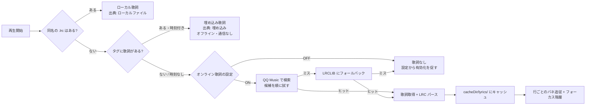
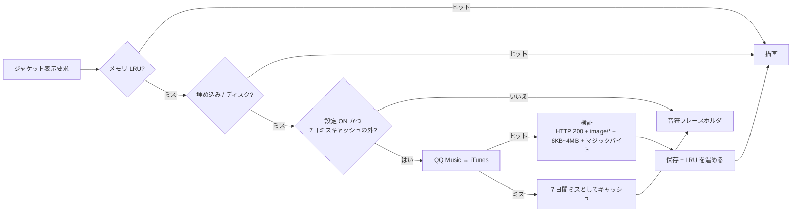

<div align="center">

# Melody Retro

**ジャケットの色が、UI の色になる。**

Android 向けのローカル音楽プレイヤーです。[RetroMusicPlayer](https://github.com/RetroMusicPlayer/RetroMusicPlayer)
のデザイン言語を Kotlin + Jetpack Compose で一から実装し直したもので、
再生中の曲のジャケットからアクセントカラーを抜き出して画面全体に反映します。
曲が変われば、UI の色も変わります。


[简体中文](README.md) | [English](README.en.md) | **日本語**

</div>

---

## 目次

- [ざっくり言うと](#ざっくり言うと)
- [なぜ作ったか](#なぜ作ったか)
- [機能](#機能)
- [パイプラインの話](#パイプラインの話)
- [クイックスタート](#クイックスタート)
- [ディレクトリ構成](#ディレクトリ構成)
- [技術スタック](#技術スタック)
- [権限](#権限)
- [既知の制限](#既知の制限)
- [クレジット](#クレジット)
- [ライセンス](#ライセンス)

## ざっくり言うと

| | |
| --- | --- |
| **何** | オフライン専用の音楽プレイヤー。土台は Material 3、見た目は RetroMusicPlayer リスペクト |
| **なぜ** | 手持ちの音源、歌詞もジャケットもタグも入っていないことがざら。それを勝手に取りに行きます |
| **どう** | `MediaStore` + Media3/ExoPlayer、UI は Compose。サーバーなし、アカウントなし |
| **環境** | Kotlin 2.0.21 / `compileSdk 35` / `minSdk 24` |
| **状態** | ユニットテスト 113 件グリーン（うち 6 件は実際に外部 API を叩きます） |

テレメトリはありません。ネットワーク設定を 2 つとも OFF にすれば、リクエストはゼロです。

## なぜ作ったか

巷のローカルプレイヤーはだいたい同じ顔をしています。白いリスト、固定のアクセントカラー、
歌詞は無いか、あってもスクロールしないか。ここは意図的に 3 点だけ変えています。

1. **曲ごとに色が変わる。** `Palette` でジャケットから `vibrant` を抜き、全画面グラデーション、
   再生ボタン、シークバー、ミニプレイヤー、歌詞のハイライトまで同じ色で揃えます。
   曲を変えれば UI ごと色が変わります。
2. **歌詞とジャケットを手で用意しなくていい。** どこから拾ってきた音源は、ID3 タグも
   ジャケットも歌詞も入っていないことがざらです。こちらから探しに行き、スコアリングして、
   当たりをキャッシュします。二度目以降は通信しません。
3. **UI は主張しない。** 歌詞は左揃え。タップすると 0.4 秒光ってフェードします。
   現在行は視口の 24% の位置で止まり、動きません。次の行に移るときは、各行が距離に応じて
   ずらしながら自分のバネで追従するので、テキストの塊が滑るのではなく波になります。
   遠い行は薄くなり、少しぼけます。拡縮はすべて `graphicsLayer` だけなのでレイアウトは
   再計算されず、リストが飛ぶこともありません。
4. **上下はスワイプ一発。** プレイヤーを下にスワイプすれば畳まれ、ミニプレイヤーを上に
   スワイプすれば開きます。パネルごと平行移動するだけで、拡大も変形もしません。上端は指に
   そのまま追従し、最後はミニプレイヤーとクロスフェード。離した位置と速度で行き先が決まり、
   再生は止まりません。

## 機能

| | |
| --- | --- |
| **スキャン** | `MediaStore` で全音声ファイルを走査（MP3 / FLAC / M4A / OGG / WAV / AIFF）。着メロなどの短い音源は除外。タイトル / 追加日時 / アーティストでソート |
| **ブラウズ** | 曲一覧（インクリメンタル検索、再生中ハイライト）、アルバムのアダプティブグリッド、アーティストの円形リスト、それぞれ詳細画面あり |
| **再生** | 再生 / 一時停止 / 前へ / 次へ / シーク / シャッフル / 1 曲リピート / 全曲リピート |
| **バックグラウンド** | `MediaSessionService` + ExoPlayer。通知とロック画面の操作、オーディオフォーカス、イヤホンを抜くと自動停止、画面 OFF でも再生継続 |
| **歌詞** | 同名 `.lrc` → ファイル内のタグ → QQ Music → LRCLIB の順。行ごとのバネ追従、タップでシーク、結果はディスクにキャッシュ |
| **ジャケット** | 埋め込み優先。無ければタイトル / アルバム / アーティストで検索し、スコアリングして検証してから保存 |
| **曲情報** | アーティスト名の下に 1 行：`FLAC • 24-bit • 1411 kb/s • 48 kHz`。ON/OFF 可 |
| **見た目** | ジャケット由来のパレット、ライト / ダーク / システム追従、スマホは `NavigationBar`、タブレットは `NavigationRail` |
| **設定** | 歌詞の文字サイズ 0.8〜1.5 倍（既定 1.2 倍）、行間 2〜24dp（既定 4dp、プレビュー付き）、曲情報の ON/OFF、ネットワーク 2 つの ON/OFF。すべて DataStore に永続化 |

## パイプラインの話

**歌詞。** 同名 `.lrc` が最優先、次にファイル自身が持っているタグ、それでも無ければネットワーク。
オンラインはベストエフォートで、全滅したらプレースホルダに落ちます。エラーダイアログは出しません。
タグに入っている歌詞はたいていタイムスタンプ付きなので、**通信ゼロでスクロールする曲**も多いです。



> 時刻の無いプレーンテキストでも表示はしますが、スクロールしません（出典ラベルに「時刻なし」と出ます）。
> QQ Music の段では候補を順に試し、時刻付きの歌詞が返ってきた時点で確定します。
> 検索の先頭はカバーや別アップロードが占めていて、時刻が入っていないことがよくあるためです。

**ジャケット。** 最初に当たったものが勝ち。「別のソースでも確認しておくか」はやりません。
レートリミットを食らうだけなので。



スコアリングの表、キャッシュ構成、同時実行数の制限、失敗時の文言は
[`MelodyRetro/README.md`](MelodyRetro/README.md)（中国語）の第 4・5 章にまとめてあります。

## クイックスタート

**必要なもの：** JDK 17、Android SDK Platform 35、Build Tools 35.0.0。Android Studio は不要です。

```bash
git clone https://github.com/Sanye223/Melody-Retro.git
cd Melody-Retro

# Windows: JDK 17 と Android SDK を .buildtools/ に入れて、ライセンスに同意し、
# local.properties まで書いてくれます。
powershell -ExecutionPolicy Bypass -File tools\setup-buildtools.ps1

cd MelodyRetro
./gradlew.bat --no-daemon --console=plain assembleDebug
```

> Android Studio が入っているならスクリプトは不要です。`MelodyRetro/local.properties` の
> `sdk.dir` が、platform 35 と build-tools 35.0.0 の入った SDK を指していれば大丈夫です。

実機へ（初回起動時に音声の権限を許可してください）：

```bash
adb install -r MelodyRetro/dist/Melody-Retro-2.5.0-release.apk
```

> 注意：release ビルドは**わざと debug キーストアで署名**しています。すぐ入れて触れるようにするためです。
> 配布する前に、自分のキーストアへ差し替えてください。

テスト（113 件。うち 6 件は実際に外部 API を叩き、圏外なら `assumeTrue` でスキップします）：

```bash
./gradlew.bat testDebugUnitTest
```

## ディレクトリ構成

```
.
├── MelodyRetro/
│   ├── app/src/main/java/com/melody/player/   # namespace は com.melody.player のまま
│   │   ├── data/       # MediaStore 走査、ジャケット、歌詞、曲情報、DataStore
│   │   ├── playback/   # MediaSessionService + PlayerManager
│   │   └── ui/         # Compose。theme/RetroColors.kt がジャケットからの色抽出
│   ├── app/src/test/   # ユニットテスト 113 件（実通信のスモークテスト込み）
│   ├── tools/          # 実機検証スクリプト + サンプル音源
│   └── dist/           # ビルド済み APK
├── tools/              # 環境構築 + 共有パッケージ作成スクリプト
├── HANDOFF.md          # 引き継ぎ資料：コードマップ、外部 API の罠、守るべき不変条件
└── backup/             # 旧版 2.3.0（gitignore 済み）
```

## 技術スタック

| レイヤ | 採用 |
| --- | --- |
| 言語 / UI | Kotlin 2.0.21 + Jetpack Compose（BOM 2024.10.01、Material 3 1.3.x） |
| 再生 | Media3 / ExoPlayer 1.4.1（`ExoPlayer` + `MediaSession` + `MediaSessionService`） |
| 画面遷移 / 状態 | Navigation Compose + ViewModel + `StateFlow` |
| 永続化 | DataStore Preferences |
| 画像 | 読み込みは Coil、色抽出は `Palette` |
| 通信 | `HttpURLConnection` 直叩き。HTTP クライアントの依存は入れていません |
| 設計 | 単一 Activity、MVVM。バックエンドもアカウントもありません |

## 権限

| 権限 | 用途 |
| --- | --- |
| `READ_MEDIA_AUDIO`（13+）/ `READ_EXTERNAL_STORAGE`（12 以下） | ローカル音源の走査 |
| `POST_NOTIFICATIONS`（13+） | メディア通知 |
| `FOREGROUND_SERVICE(_MEDIA_PLAYBACK)` | バックグラウンド再生 |
| `WAKE_LOCK` | 画面 OFF でも再生を継続 |
| `INTERNET` | オンライン歌詞とジャケットのみ。両方 OFF なら一切通信しません |

オンラインリクエストで送るのは**タイトル / アーティスト / アルバム / 再生時間**だけです。
端末 ID、アカウント、再生履歴は送りません。音源・ジャケット・プレイリストは端末から出ません。

## 既知の制限

- 再生しかできません。プレイリスト管理、イコライザ、タグ編集、ホーム画面ウィジェット、
  スリープタイマーはありません。**仕様です。**
- オンライン機能は非公開の公開 API（QQ Music / iTunes / LRCLIB）に依存しています。
  **いつ壊れても不思議ではありません。** API キーがあるわけでもないので、壊れたら直すしかありません。
  エンドポイントと踏んだ罠は [`HANDOFF.md`](HANDOFF.md)（中国語）の 3〜4 章に全部書いてあります。
  次の人が同じ沼にハマらないように。
- 埋め込みジャケットも無く、ファイル名からも曲名が推測できない場合はプレースホルダのままです。
  さすがにそこまでは無理です。
- 実機 1 台でしか検証していません。**あなたの端末で動く保証はありません。**

## クレジット

[RetroMusicPlayer](https://github.com/RetroMusicPlayer/RetroMusicPlayer) のデザインを勝手にリスペクトしています。
合わせたのはこのあたり：

| 合わせたもの | 出典 |
| --- | --- |
| 操作ボタンの並び `repeat → previous → playPause → next → shuffle`、再生ボタンは円形 FAB | `fragment_adaptive_player_playback_controls.xml` |
| シークバーの左右にタイムスタンプを 1 つずつ | 同上 |
| ミニプレイヤーは高さ 56dp、ジャケット 40dp、タイトルは 1 行だけ | `fragment_mini_player.xml` |
| 曲情報を ` • ` 区切りの小さい 1 行で | `getSongInfo()` |
| アルバム / アーティストの詰まったグリッド（角丸 10dp、間隔 10dp） | 各 item レイアウト |

UI は Kotlin + Compose で書き直しています。本家は `compileSdk 36` + KSP/Realm の
クラシックな View/XML なので、コードは一切流用していません。参考にしたのはデザイン仕様と
レイアウトの数値だけです。**車輪の再発明はしていません**が、タイヤの径は合わせてあります。

RetroMusicPlayer の作者とコントリビュータに感謝します。
このデザイン言語は、一度 Compose で書き直される価値がありました。

### 歌詞のモーション

歌詞のフォーカス行スクロールと階層は **[Kifranei/Halcyon](https://github.com/Kifranei/Halcyon)**
（Apache-2.0）からの移植です。`ui/components/LyricFocusMotion.kt` は本家の `ReferenceLyricMotion.kt`、
`LyricsContent` は `AppleMusicLyricsView.kt` + `AppleMusicLyricLine.kt` が元になっています。

持ってきたのはアルゴリズムと数値です。閉形式のバネ、`CubicBezier(.4, .1, 0, 1)` のカーブ、
1 行あたり 30ms のずらし、「レイアウトを飛ばして各行がバネで追いかける」スクロールモデル、
1.0 / 0.98 のスケールと 0.24→0.13 の透明度。持ってきていないのは、単語単位のタイミングが
無いので語ごとのリフトとカラオケ塗りはやっていない点と、フォーカス行の色が単色ではなく
ジャケット由来のアクセント色になっている点です。

Apache-2.0 の都合で通知を残す必要があるので、移植したファイルの先頭に帰属を書いてあります。

## ライセンス

**GPL-3.0**（本家と同じ）。

```
Copyright (C) 2026 Sanye223

This program is free software: you can redistribute it and/or modify
it under the terms of the GNU General Public License as published by
the Free Software Foundation, either version 3 of the License, or
(at your option) any later version.
```

使うもよし、フォークするもよし、売るもよし。ただし派生物を配布するなら GPL-3.0 で、
ソース付きでお願いします。全文は [`LICENSE`](LICENSE) にあります。

---

個人開発なので**無保証**です。issue と PR は歓迎しますが、対応はベストエフォートで。
（仕事じゃないので、定時で帰ります。）

---

<div align="center">

<sub><code>com.melody.retro</code> · versionCode 15 · 2.5.0-retro</sub>

</div>
