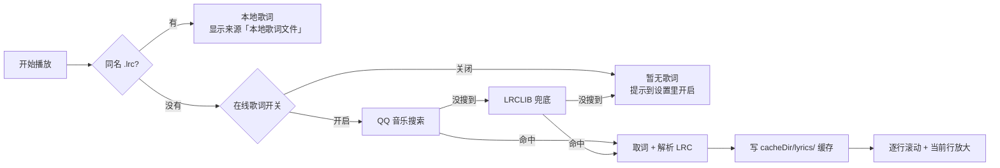
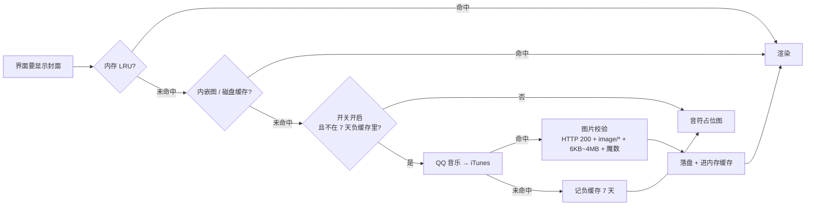
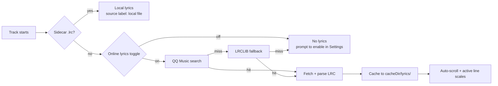
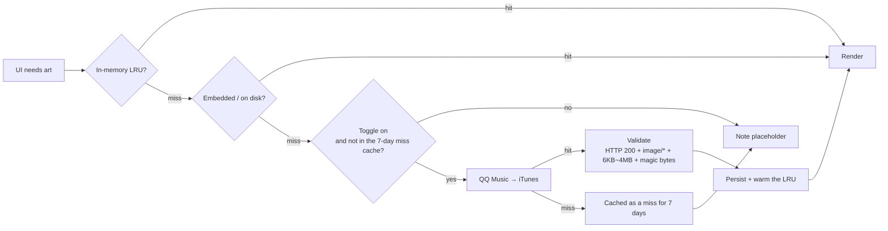

<div align="center">

# Melody Retro

**封面是什么颜色，界面就是什么颜色。**

一个完全离线的 Android 本地音乐播放器，基于
[RetroMusicPlayer](https://github.com/RetroMusicPlayer/RetroMusicPlayer) 的设计语言重做，
主题色由当前歌曲封面实时提取 —— 换一首歌，整个界面跟着变。


[**English**](#english) | 简体中文

</div>

---

## 目录

- [它解决什么问题](#它解决什么问题)
- [功能](#功能)
- [两个核心链路](#两个核心链路)
- [快速开始](#快速开始)
- [项目结构](#项目结构)
- [技术栈](#技术栈)
- [权限](#权限)
- [已知限制](#已知限制)
- [来源与致谢](#来源与致谢)
- [许可证](#许可证)
- [文档](#文档)
- [**English version**](#english)

---

## 它解决什么问题

安卓上的本地音乐播放器，大部分长这样：白底列表、固定主色、歌词要么没有要么不同步。
这个项目想做三件事：

1. **每首歌都有自己的颜色。** 用 `Palette` 从封面取 `vibrant` 色，驱动播放页的整屏渐变、播放键、
   进度条、迷你播放器和歌词高亮 —— 全部同色，换歌即换色。
2. **不用手动准备歌词和封面。** 手机里那些从各处下载来的 MP3，一半没有 ID3 标签、没有封面、
   没有歌词。播放器自己去 QQ 音乐、iTunes、LRCLIB 找，找到就缓存，下次不再联网。
3. **界面别抢戏。** 歌词左对齐、点击瞬亮 0.4 秒后淡出、当前行平滑放大 10%（只改绘制矩阵，
   不参与布局，绝不跳行）。没有花哨的色块和边框。

## 功能

| 分类 | 说明 |
| --- | --- |
| 本地扫描 | `MediaStore` 扫描全部音频（MP3 / FLAC / M4A / OGG / WAV / AIFF），过滤铃声等短音频，支持按标题 / 添加时间 / 艺术家排序 |
| 浏览 | 歌曲列表（实时搜索、当前播放高亮）、专辑自适应网格、艺术家圆形列表，各自带详情页 |
| 播放 | 播放 / 暂停 / 上一曲 / 下一曲 / 进度拖动 / 随机 / 单曲循环 / 列表循环 |
| 后台 | `MediaSessionService` + ExoPlayer，通知栏与锁屏控制、音频焦点、拔耳机自动暂停、息屏继续放 |
| 歌词 | 本地 `.lrc` → QQ 音乐 → LRCLIB 三级加载，逐行滚动、点击跳转、结果落盘缓存 |
| 封面 | 内嵌封面优先，缺失时按 歌名 / 专辑 / 艺术家 联网检索，打分筛选、图片校验、负缓存 |
| 歌曲信息 | 歌手名下方一行小字：`FLAC • 24-bit • 1411 kb/s • 48 kHz`，可开关 |
| 外观 | 封面取色、浅色 / 深色 / 跟随系统、手机 `NavigationBar` / 平板 `NavigationRail` 自适应 |
| 设置 | 歌词字号 0.8~1.5×、行距 2~24dp（带实时预览）、歌曲信息开关、两个联网开关，全部 DataStore 持久化 |

## 两个核心链路

**歌词**：本地有就用本地的，没有才联网，两条路都失败才显示"暂无歌词"。



**封面**：任何一步命中就停，绝不为了"更好看"重复联网。



两个链路的完整策略（匹配打分表、缓存目录、并发限制、降级话术）见
[`MelodyRetro/README.md`](MelodyRetro/README.md) 第 4、5 章。

## 快速开始

**环境要求**：JDK 17、Android SDK Platform 35、Build Tools 35.0.0。不需要装 Android Studio。

```bash
git clone https://github.com/Sanye223/Melody-Retro.git
cd Melody-Retro

# 一键装 JDK 17 + Android SDK 到项目内 .buildtools/（Windows）
powershell -ExecutionPolicy Bypass -File tools\setup-buildtools.ps1

# 构建
cd MelodyRetro
./gradlew.bat --no-daemon --console=plain assembleDebug
```

> 已有 Android Studio 的话跳过第 2 步，只需保证 `MelodyRetro/local.properties` 里的
> `sdk.dir` 指向你的 SDK（compileSdk 35 / build-tools 35.0.0）。

装到手机（首次启动需要授予「音乐和音频」权限）：

```bash
adb install -r MelodyRetro/dist/Melody-Retro-2.4.2-release.apk
```

> Release 包用的是 **debug 签名**，目的是能直接装上体验。要正式分发请换成你自己的 keystore。

跑测试（57 项，其中 6 项会真实联网，断网自动跳过）：

```bash
./gradlew.bat testDebugUnitTest
```

## 项目结构

```
.
├── MelodyRetro/
│   ├── app/src/main/java/com/melody/player/     # 源码（namespace 仍是 com.melody.player）
│   │   ├── data/          # MediaStore 扫描、封面、歌词、歌曲信息、DataStore
│   │   ├── playback/      # MediaSessionService + PlayerManager
│   │   └── ui/            # Compose 界面，theme/RetroColors.kt 是封面取色
│   ├── app/src/test/      # 57 项单元测试（含真实联网冒烟）
│   ├── tools/             # 真机验证脚本 + 测试音频
│   └── dist/              # 打好的 APK
├── tools/                 # 环境自举 + 分享包打包脚本
├── HANDOFF.md             # 给接手者 / AI 的说明书
└── backup/                # 上一版 2.3.0 归档（.gitignore，未推送）
```

## 技术栈

| 层 | 选型 |
| --- | --- |
| 语言 / UI | Kotlin 2.0.21 + Jetpack Compose（BOM 2024.10.01，Material 3 1.3.x） |
| 播放 | Media3 / ExoPlayer 1.4.1（`ExoPlayer` + `MediaSession` + `MediaSessionService`） |
| 导航 / 状态 | Navigation Compose + ViewModel + `StateFlow` |
| 持久化 | DataStore Preferences |
| 图片 | Coil（加载）+ Palette（取色） |
| 网络 | 原生 `HttpURLConnection`，无三方库 |
| 架构 | 单 Activity、MVVM，无后端无账号 |

## 权限

| 权限 | 用途 |
| --- | --- |
| `READ_MEDIA_AUDIO`（13+）/ `READ_EXTERNAL_STORAGE`（≤12） | 扫描本地音频 |
| `POST_NOTIFICATIONS`（13+） | 媒体播放通知 |
| `FOREGROUND_SERVICE(_MEDIA_PLAYBACK)` | 后台播放 |
| `WAKE_LOCK` | 息屏继续播放 |
| `INTERNET` | 仅用于在线歌词与在线封面；两个开关都关掉后不发起任何网络请求 |

在线请求只发送歌曲的**标题 / 艺术家 / 专辑 / 时长**，不发送设备标识、账号或播放记录。
音频、封面、播放列表全部留在本机。

## 已知限制

- 只做了**播放**：没有播放列表管理、均衡器、标签编辑、桌面小部件、睡眠定时。
- 在线歌词与封面依赖第三方公开接口（QQ 音乐 / iTunes / LRCLIB），**对方改动就失效**，
  接口细节与踩过的坑记录在 [`HANDOFF.md`](HANDOFF.md) 第 3、4 节。
- 音乐文件本身没有内嵌封面、文件名也不含歌名和艺术家时，猜不准就只能显示占位图。
- 只在个人真机上验证过，没有做多机型 / 多分辨率测试。

## 来源与致谢

本项目的**视觉语言与交互规范来自 [RetroMusicPlayer](https://github.com/RetroMusicPlayer/RetroMusicPlayer)**。
下面这些都是照它的实现对齐的：

| 照它实现的 | 出处（原项目文件） |
| --- | --- |
| 播放控制区顺序 `repeat → previous → playPause → next → shuffle`，播放键为圆形 FAB | `fragment_adaptive_player_playback_controls.xml` |
| 进度条两侧各放一个时间标签，时间与滑杆同一行 | 同上 |
| 迷你播放器 56dp 高、40dp 封面、只显示一行歌名 | `fragment_mini_player.xml` |
| 歌曲信息 `FLAC • 24-bit • 1411 kb/s • 48 kHz` 单行居中小字 | `getSongInfo()` |
| 专辑 / 艺术家紧凑网格（10dp 圆角、10dp 间距） | 各 item 布局 |

**关于实现方式**：界面用 Kotlin + Jetpack Compose 重新实现 —— 原项目是 `compileSdk 36` +
KSP/Realm 的传统 View + XML 架构，代码无法直接复用，本仓库**没有包含它的 Java / View / XML 代码**，
对齐的是设计规范与布局参数。

感谢 RetroMusicPlayer 的作者与所有贡献者 —— 这套设计语言值得被单独做一次实现。

## 许可证

本项目**以 [GPL-3.0](LICENSE) 开源**，与 RetroMusicPlayer 保持一致。

```
Copyright (C) 2026 Sanye223

This program is free software: you can redistribute it and/or modify
it under the terms of the GNU General Public License as published by
the Free Software Foundation, either version 3 of the License, or
(at your option) any later version.
```

这意味着你可以自由地使用、修改、再分发，包括商用；但**分发衍生作品时必须同样以 GPL-3.0 开源**，
并保留版权声明。完整条款见 [`LICENSE`](LICENSE)。

上游项目 [RetroMusicPlayer](https://github.com/RetroMusicPlayer/RetroMusicPlayer) 同样以 GPL-3.0 发布。

## 文档

| 文件 | 内容 |
| --- | --- |
| [`MelodyRetro/README.md`](MelodyRetro/README.md) | 完整技术文档：设计语言与取色实现、歌词容错矩阵、封面打分表、缓存与 LRU、工程结构 |
| [`HANDOFF.md`](HANDOFF.md) | 交接说明：三步上手、代码地图、外部接口的四个坑、7 条改动不变式、待验证项 |

---

## English

<sub>[↑ 回到中文](#melody-retro)</sub>

### TL;DR

| | |
| --- | --- |
| **What** | Offline music player, Material 3 bones, RetroMusicPlayer's skin |
| **Why** | Half your library has no lyrics, no cover art, no tags. This one goes and gets them. |
| **How** | `MediaStore` + Media3/ExoPlayer, Compose UI, zero backend, no account |
| **Stack** | Kotlin 2.0.21 · `compileSdk 35` · `minSdk 24` |
| **State** | 57 unit tests green, 6 of them hit live endpoints |

No telemetry. Two network switches, both off = zero requests.

### Why bother

Most local players look the same: white list, one fixed accent color, lyrics that either don't
exist or don't scroll. Three things here are deliberately different:

1. **Every track gets its own palette.** `Palette` pulls `vibrant` out of the cover art and drives
   the whole player — full-screen gradient, play button, seek bar, mini player, lyric highlight.
   Change the track, the entire UI changes with it.
2. **You don't hand-curate lyrics and art.** Files ripped from wherever usually ship without ID3
   tags, without embedded art, without lyrics. The app goes out and finds them, scores the matches,
   caches the winners, and never asks again.
3. **The UI stays out of the way.** Lyrics are left-aligned. Tap one and it flashes for 0.4s, then
   fades. The active line scales to 1.10× — `graphicsLayer` only, so it never re-measures and never
   makes the list jump.

### Features

| | |
| --- | --- |
| **Scan** | `MediaStore` sweep over every audio file (MP3 / FLAC / M4A / OGG / WAV / AIFF), short clips like ringtones filtered out. Sort by title / date added / artist |
| **Browse** | Song list with live search and now-playing highlight, adaptive album grid, circular artist list, detail screens for both |
| **Playback** | Play / pause / prev / next / seek / shuffle / repeat-one / repeat-all |
| **Background** | `MediaSessionService` + ExoPlayer: notification and lock-screen controls, audio focus, pause on headphone unplug, keeps playing screen-off |
| **Lyrics** | Sidecar `.lrc` → QQ Music → LRCLIB. Auto-scroll, tap-to-seek, results cached to disk |
| **Cover art** | Embedded art first; otherwise queried by title / album / artist, scored, validated, cached |
| **Track info** | One small line under the artist: `FLAC • 24-bit • 1411 kb/s • 48 kHz`. Toggleable |
| **Looks** | Artwork-driven palette, light / dark / system, `NavigationBar` on phones and `NavigationRail` on tablets |
| **Settings** | Lyric font scale 0.8–1.5×, line spacing 2–24dp (live preview), track-info toggle, two network toggles. All persisted via DataStore |

### Under the hood: the two pipelines

**Lyrics.** Local beats remote. Remote is best-effort, and a total miss degrades to a placeholder —
never an error dialog.



**Cover art.** First hit wins. No "let me double-check with another source" — that's how you get
rate-limited.



Full scoring tables, cache layout, concurrency limits and every user-facing string per failure
mode live in [`MelodyRetro/README.md`](MelodyRetro/README.md) (Chinese) — chapters 4 and 5.

### Quick start

**Needs:** JDK 17, Android SDK Platform 35, Build Tools 35.0.0. No Android Studio required.

```bash
git clone https://github.com/Sanye223/Melody-Retro.git
cd Melody-Retro

# Windows: bootstrap JDK 17 + the Android SDK into .buildtools/, accept licenses,
# and write local.properties for you.
powershell -ExecutionPolicy Bypass -File tools\setup-buildtools.ps1

cd MelodyRetro
./gradlew.bat --no-daemon --console=plain assembleDebug
```

> Already running Android Studio? Skip the bootstrap script. Just make sure `MelodyRetro/local.properties`
> points `sdk.dir` at an SDK with platform 35 and build-tools 35.0.0.

Ship it to a device (grant the audio permission on first launch):

```bash
adb install -r MelodyRetro/dist/Melody-Retro-2.4.2-release.apk
```

> Heads up: the release variant is **signed with the debug keystore** on purpose, so you can just
> install and poke at it. Swap in your own keystore before you distribute anything.

Tests — 57 cases, 6 of which talk to real endpoints and `assumeTrue`-skip when offline:

```bash
./gradlew.bat testDebugUnitTest
```

### Layout

```
.
├── MelodyRetro/
│   ├── app/src/main/java/com/melody/player/   # namespace is still com.melody.player
│   │   ├── data/       # MediaStore scan, artwork, lyrics, track info, DataStore
│   │   ├── playback/   # MediaSessionService + PlayerManager
│   │   └── ui/         # Compose. theme/RetroColors.kt is the artwork color extraction
│   ├── app/src/test/   # 57 unit tests, incl. live smoke tests
│   ├── tools/          # on-device verification script + sample audio
│   └── dist/           # prebuilt APKs
├── tools/              # toolchain bootstrap + share-package builder
├── HANDOFF.md          # hand-off notes: code map, API gotchas, invariants
└── backup/             # previous 2.3.0 build (gitignored)
```

### Stack

| Layer | Pick |
| --- | --- |
| Language / UI | Kotlin 2.0.21 + Jetpack Compose (BOM 2024.10.01, Material 3 1.3.x) |
| Playback | Media3 / ExoPlayer 1.4.1 (`ExoPlayer` + `MediaSession` + `MediaSessionService`) |
| Nav / state | Navigation Compose + ViewModel + `StateFlow` |
| Persistence | DataStore Preferences |
| Images | Coil to load, `Palette` to extract |
| Networking | Plain `HttpURLConnection`, no HTTP client dependency |
| Architecture | Single Activity, MVVM, no backend, no account |

### Permissions

| Permission | Why |
| --- | --- |
| `READ_MEDIA_AUDIO` (13+) / `READ_EXTERNAL_STORAGE` (≤12) | Scan local audio |
| `POST_NOTIFICATIONS` (13+) | Media notification |
| `FOREGROUND_SERVICE(_MEDIA_PLAYBACK)` | Background playback |
| `WAKE_LOCK` | Keep playing with the screen off |
| `INTERNET` | Online lyrics and cover art only. Both toggles off = no requests at all |

Online requests carry **title / artist / album / duration** and nothing else — no device ID, no
account, no listening history. Audio, artwork and playlists never leave the device.

### Known limits

- It plays music. That's the whole feature set. No playlist management, no EQ, no tag editor,
  no home-screen widget, no sleep timer.
- The online features lean on undocumented public endpoints (QQ Music / iTunes / LRCLIB). **They will
  break eventually**, and there's no API key to fall back on. The endpoints and every gotcha we hit
  are documented in [`HANDOFF.md`](HANDOFF.md) (Chinese) §3–4, so the next person doesn't have to
  rediscover them.
- No embedded art + a filename that gives nothing away = placeholder art. Can't magic it.
- Tested on exactly one physical device. YMMV.

### Credits

Shamelessly built on the design work of
[RetroMusicPlayer](https://github.com/RetroMusicPlayer/RetroMusicPlayer). Aligned with it:

| What | Where it came from |
| --- | --- |
| Control order `repeat → previous → playPause → next → shuffle`, FAB play button | `fragment_adaptive_player_playback_controls.xml` |
| One timestamp on each side of the seek bar | same |
| Mini player at 56dp with 40dp art and a single title line | `fragment_mini_player.xml` |
| Track info as one ` • `-separated line of small type | `getSongInfo()` |
| Tight album / artist grids (10dp radius, 10dp gutter) | item layouts |

The UI here is Kotlin + Compose; upstream is `compileSdk 36` + KSP/Realm + classic View/XML, so no
code was lifted — what's shared is the design spec and the layout numbers.

Hat tip to the RetroMusicPlayer authors and contributors. This design language deserved its own
Compose implementation.

### License

**GPL-3.0**, same as upstream.

```
Copyright (C) 2026 Sanye223

This program is free software: you can redistribute it and/or modify
it under the terms of the GNU General Public License as published by
the Free Software Foundation, either version 3 of the License, or
(at your option) any later version.
```

Use it, fork it, ship it, sell it — but if you distribute a derivative, it ships under GPL-3.0 too,
source included. Full text in [`LICENSE`](LICENSE).

---

<div align="center">

<sub><code>com.melody.retro</code> · versionCode 7 · 2.4.2-retro</sub>

</div>
